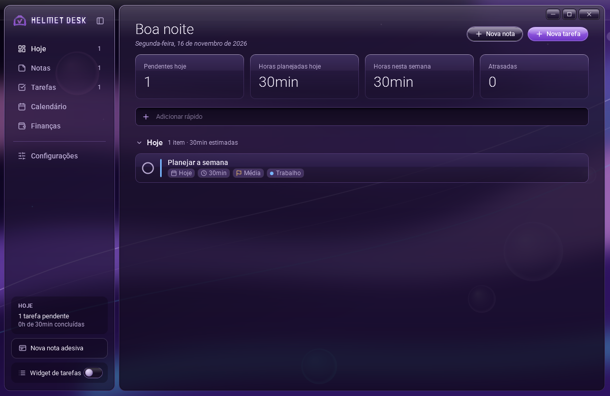
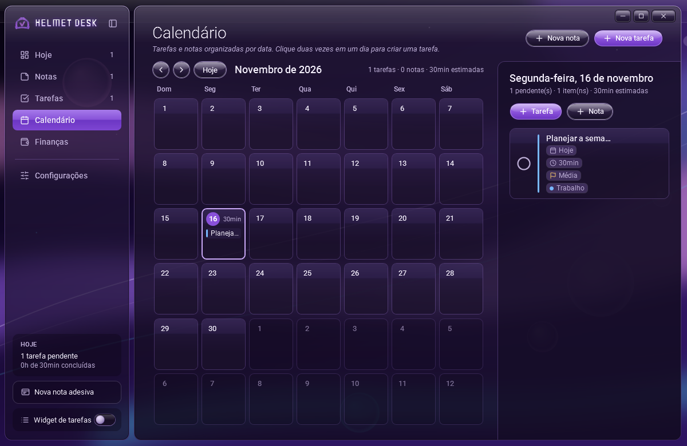
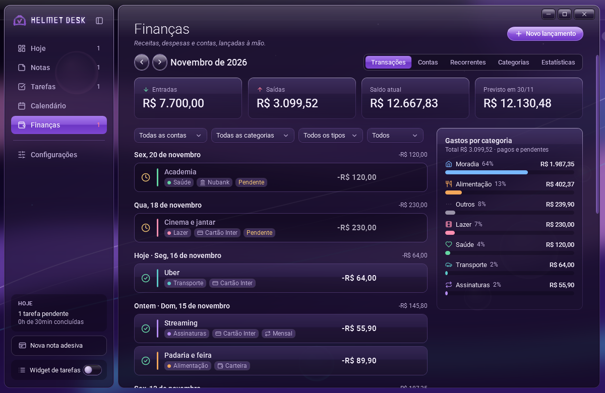
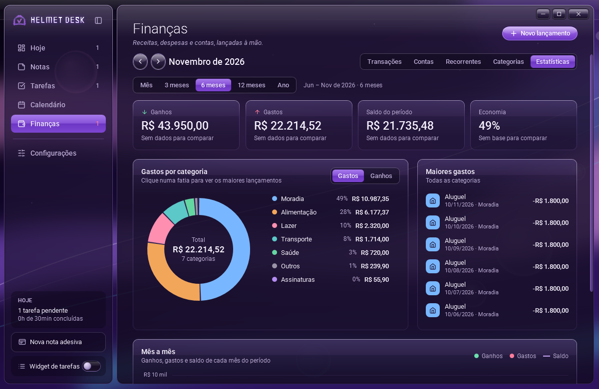

# Helmet Desk

Notas, tarefas, calendário e finanças pessoais num só lugar, para Windows. Tudo fica salvo no seu computador.



**[⬇ Baixar a versão mais recente](https://github.com/derpbizinoto/helmet-desk/releases/latest)**: Windows 10 e 11, 64 bits.

## Recursos

- **Hoje**: resumo do dia com pendentes, horas planejadas, atrasadas e um campo de adição rápida que entende linguagem natural ("Revisar roteiro amanhã às 14h 1h30").
- **Notas e tarefas**: checklist, data, horário, prioridade, tempo estimado, etiquetas coloridas, anexos (imagens e arquivos) e links com título e ícone do site.
- **Calendário**: o mês inteiro, com os itens de cada dia. Clique duas vezes num dia para criar uma tarefa.
- **Finanças**: lançamentos manuais, contas e cartões, parcelas, recorrentes, categorias e estatísticas com gráficos. Nada é conectado ao banco.
- **Na área de trabalho**: notas adesivas e um widget com a lista de tarefas.
- **Lembretes**: notificação na hora marcada da tarefa, ícone na bandeja e opção de iniciar com o Windows.
- **Backup**: exporta e importa um `.zip` com todos os dados e anexos, conferido antes de restaurar.
- **Temas**: Frutiger Aero (vidro roxo com aurora) e Clássico (escuro).
- **Atualização automática**: avisa quando há uma versão nova e instala com um clique.

| Calendário | Finanças | Estatísticas |
|---|---|---|
|  |  |  |

## Instalação

1. Baixe o **`HelmetDesk-win-Setup.exe`** na [página de releases](https://github.com/derpbizinoto/helmet-desk/releases/latest) e abra.
2. Pronto: o app abre sozinho e cria atalhos na área de trabalho e no Menu Iniciar. Não é preciso instalar o .NET.

> O instalador ainda não tem assinatura digital. Se o Windows mostrar "O Windows protegeu o computador",
> clique em **Mais informações → Executar assim mesmo**.

Para instalar **para todos os usuários do PC** (em `C:\Program Files`), use o **`HelmetDesk-win.msi`**.
Nesse modo, o Windows pede permissão de administrador ao instalar e a cada atualização.

## Atualizações

O Helmet Desk procura versões novas ao abrir. Quando acha uma, baixa em segundo plano e avisa **"Nova versão pronta"**:

- **Reiniciar e atualizar** instala na hora;
- se você ignorar o aviso, a atualização é instalada quando você fechar o app (na instalação para todos os usuários, só pelo botão).

A versão atual e o botão **Verificar atualizações** ficam em *Configurações → Atualizações*.

## Seus dados

| O quê | Onde |
|---|---|
| Notas, tarefas, finanças, anexos | `%AppData%\HelmetDesk\` |
| Logs, cópias de segurança automáticas, relatórios de problema | `%LocalAppData%\HelmetDesk.Local\` |

- Nada é enviado para servidores. O app só usa a internet para **procurar atualizações** (nesta página do GitHub) e para **buscar o título e o ícone** dos links que você coloca nas notas.
- **Desinstalar não apaga seus dados.** Ao instalar de novo, tudo aparece como estava.
- Para levar seus dados a outro PC: *Configurações → Dados → Exportar backup* e, no outro PC, *Importar backup*.

O guia completo de uso (atalhos, adição rápida, finanças, backup) está em [`como usar.txt`](como%20usar.txt).

## Problemas e sugestões

Use *Configurações → Suporte → Reportar problema*: o app monta um `.zip` com as informações técnicas (você revisa tudo antes, e seus dados só entram se você marcar).
Você também pode abrir uma [issue](https://github.com/derpbizinoto/helmet-desk/issues).

## Desenvolvimento

Requisitos: Windows e o [.NET SDK 10](https://dotnet.microsoft.com/download/dotnet/10.0).

```
git clone https://github.com/derpbizinoto/helmet-desk.git
cd helmet-desk
dotnet build HelmetDesk.sln
dotnet test tests/HelmetDesk.Tests
```

| Pasta | Conteúdo |
|---|---|
| `src/` | App WPF (.NET 10): janelas, temas (`src/Themes`), fontes, animações e sons embutidos |
| `core/` | Serviços sem WPF: caminhos (`AppPaths`), backup, relatório de problema, regras de Finanças |
| `tests/` | Testes xUnit dos serviços |
| `docs/` | Identidade visual, roteiro de testes do instalador e capturas de tela |
| `_backup/` | Cópias da interface antiga, para consulta (não são compiladas) |

### Publicar uma versão

O instalador e as atualizações usam o [Velopack](https://velopack.io). Uma vez só:

```
dotnet tool install -g vpk
gh auth login
```

A cada versão (o número sobe: 1.0.1, 1.0.2…):

```
.\build-release.ps1 1.0.1 -Upload
```

O script compila (self-contained, win-x64), gera o Setup.exe, o MSI e o pacote delta e publica a release `v1.0.1` aqui no GitHub.
Sem `-Upload`, só gera os arquivos em `releases/`. Detalhes e testes em [`docs/velopack-roteiro-testes.md`](docs/velopack-roteiro-testes.md).

> Rode o script e os instaladores num PowerShell aberto pelo Menu Iniciar. Programas iniciados de dentro de apps
> empacotados (MSIX) podem ter a instalação redirecionada para uma pasta privada.

## Créditos

Fontes Geo e Roboto (SIL OFL), animações do LottieFiles, sons da Kenney (CC0), SkiaSharp, NAudio, Serilog e Velopack.
Detalhes e licenças em [`CREDITS.md`](CREDITS.md).
