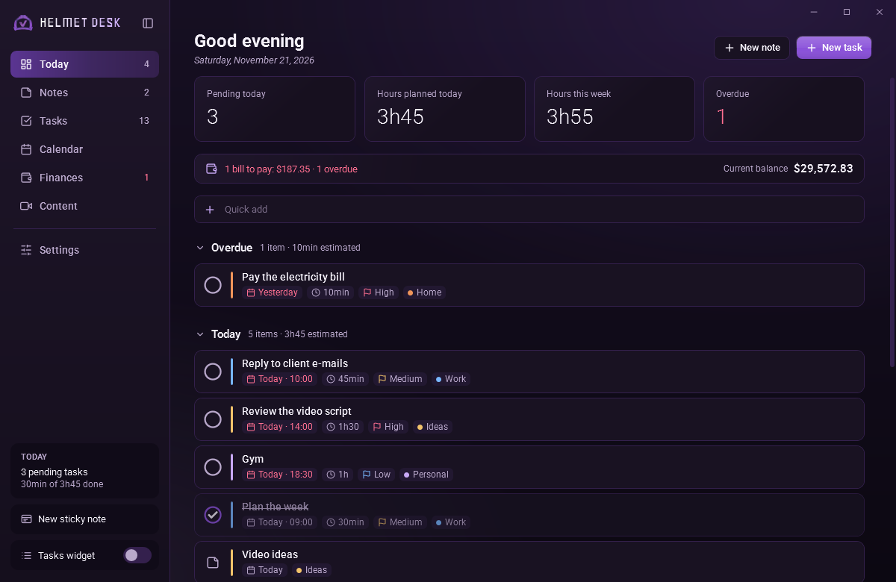
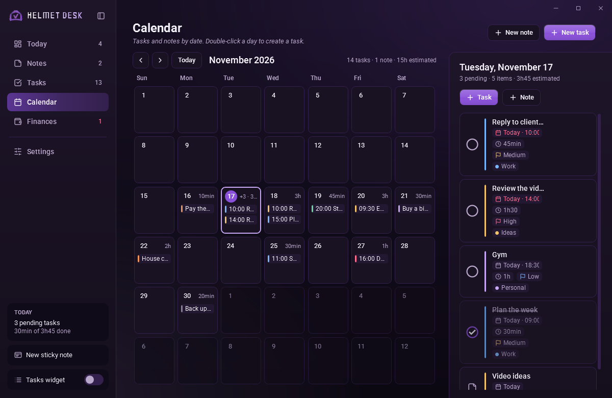
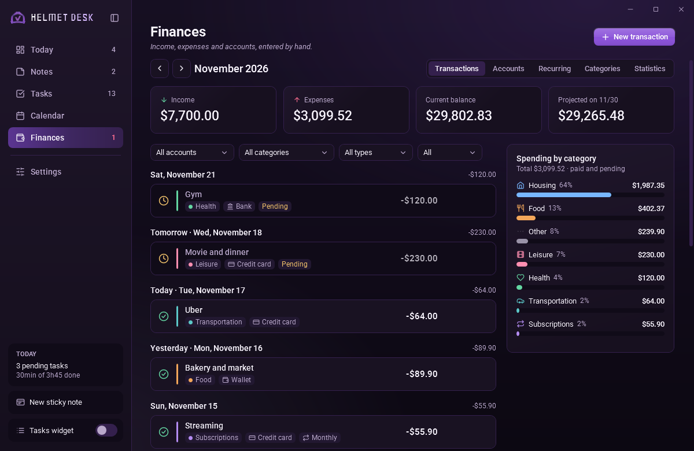
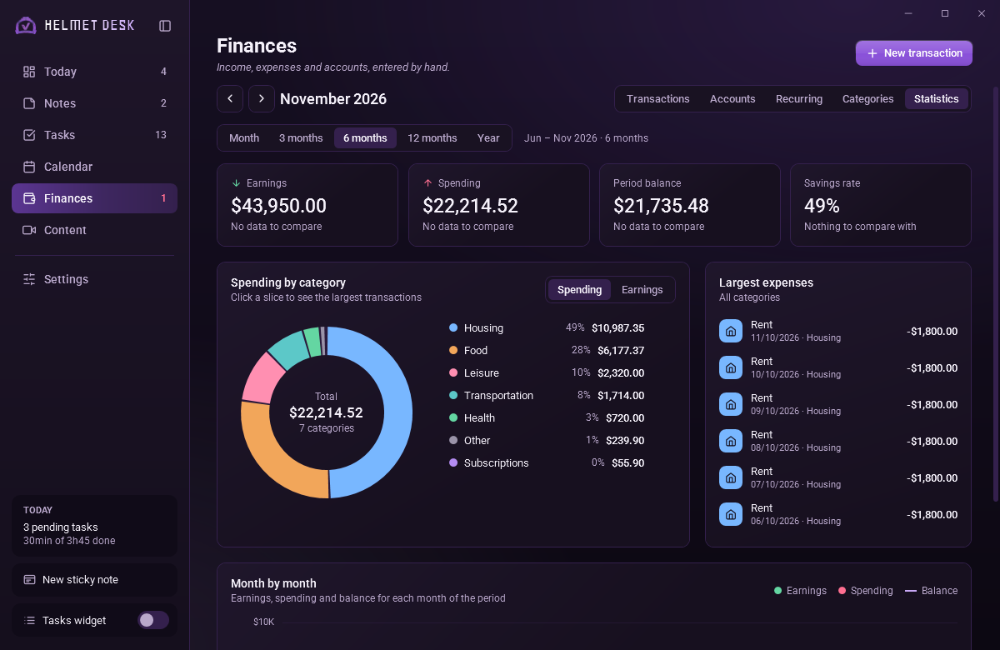
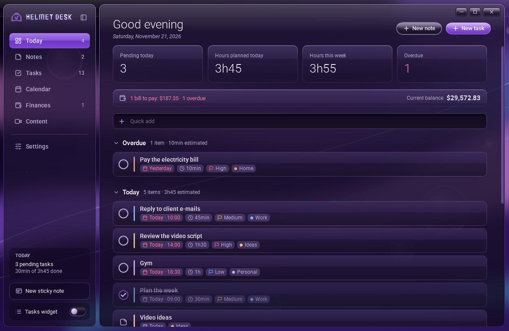
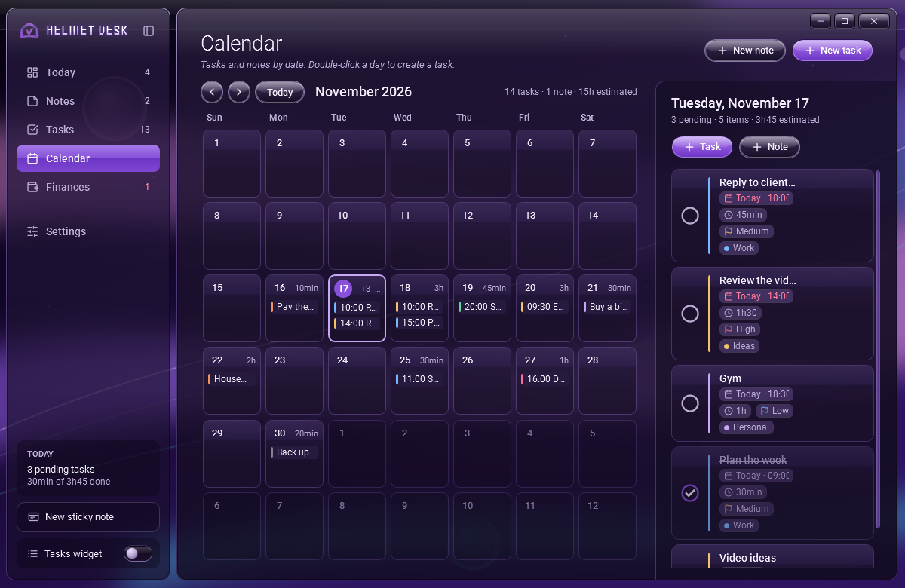
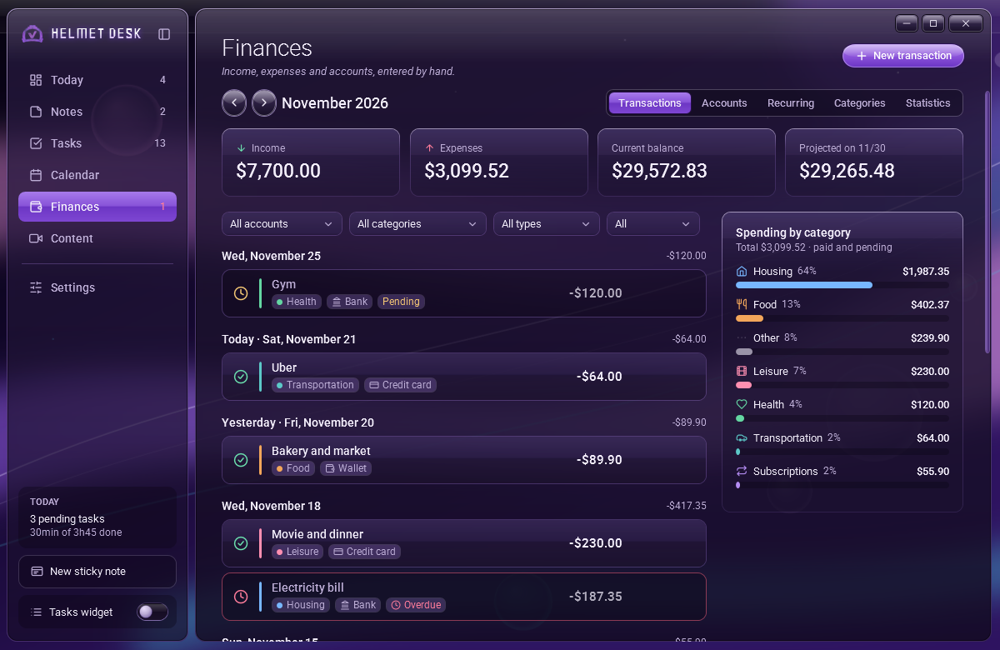
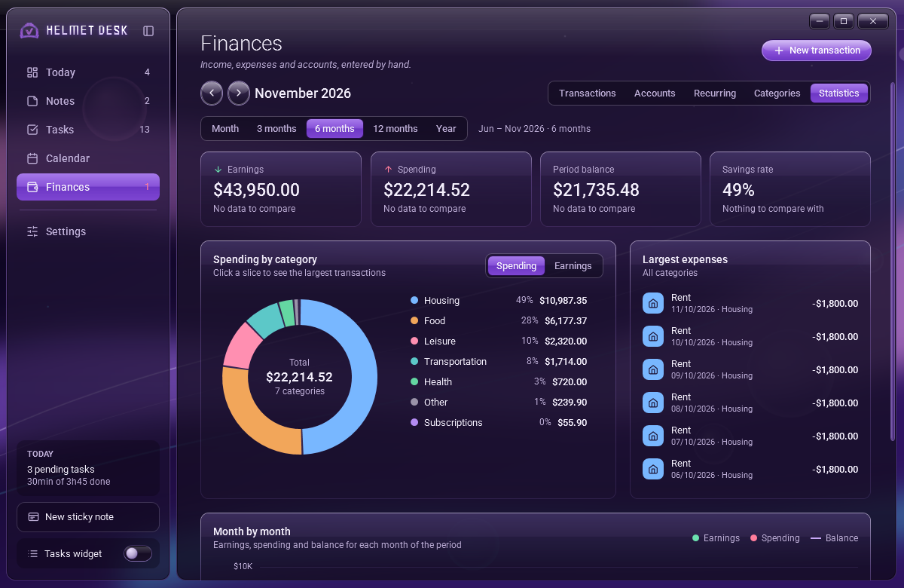

# Helmet Desk

**English** · [Português](README.pt-BR.md)

Notes, tasks, calendar and personal finances in one place, for Windows. Everything is stored on your own computer.



**[⬇ Download the latest version](https://github.com/derpbizinoto/helmet-desk/releases/latest)**: Windows 10 and 11, 64-bit.

## Features

- **Today**: a daily overview with pending items, planned hours, overdue tasks and a quick-add field that understands natural language ("Review the script tomorrow at 2pm 1h30").
- **Notes and tasks**: checklists, date, time, priority, time estimate, colored labels, attachments (images and files) and links shown with the site's title and icon.
- **Calendar**: the whole month with each day's items. Double-click a day to create a task.
- **Finances**: manually entered transactions, accounts and credit cards, installments, recurring entries, categories and statistics with charts. Nothing connects to your bank. Amounts are shown in the currency you choose: dollar ($), euro (€) or Brazilian real (R$).
- **On the desktop**: sticky notes and a task-list widget.
- **Reminders**: a notification at the task's set time, a tray icon and an option to start with Windows.
- **Backup**: export and import a `.zip` with all your data and attachments, verified before restoring.
- **Two languages**: English and Brazilian Portuguese.
- **Automatic updates**: tells you when a new version is ready and installs it in one click.

| Calendar | Finances | Statistics |
|---|---|---|
|  |  |  |

### Frutiger Aero-inspired theme

Besides the Classic dark look, there's a theme inspired by the Frutiger Aero style: purple glass over an aurora background, with glossy gel buttons. Switch in *Settings → General → Theme*; the app restarts on its own and none of your data changes.

| Today | Calendar |
|---|---|
|  |  |
| **Finances** | **Statistics** |
|  |  |

## Language and currency

- The app starts in **English**. To use it in Brazilian Portuguese, go to *Settings → General → Language* and pick **Português (Brasil)**: the app restarts in the new language. If you used Helmet Desk before version 1.0.1, it stays in Portuguese.
- Quick add understands dates and times in the app's language ("tomorrow at 3pm", "next Friday", "in 2 weeks"; in Portuguese, "amanhã às 15h", "na sexta", "daqui 2 semanas").
- The Finances currency is in *Settings → Finances → Currency*. Changing it only changes the symbol: amounts already entered are not converted.

## Installation

1. Download **`HelmetDesk-win-Setup.exe`** from the [releases page](https://github.com/derpbizinoto/helmet-desk/releases/latest) and run it.
2. That's it: the app opens on its own and adds shortcuts to the desktop and Start menu. You don't need to install .NET.

> The installer is not digitally signed yet. If Windows shows "Windows protected your PC",
> click **More info → Run anyway**.

To install **for all users on the PC** (in `C:\Program Files`), use **`HelmetDesk-win.msi`**.
In this mode, Windows asks for administrator permission when installing and on every update.

## Updates

Helmet Desk checks for new versions when it opens. When it finds one, it downloads it in the background and shows **"New version ready"**:

- **Restart and update** installs it right away;
- if you ignore the notice, the update is installed when you close the app (for all-users installs, only through the button).

The current version and the **Check for updates** button are in *Settings → Updates*.

## Your data

| What | Where |
|---|---|
| Notes, tasks, finances, attachments | `%AppData%\HelmetDesk\` |
| Logs, automatic safety backups, problem reports | `%LocalAppData%\HelmetDesk.Local\` |

- Nothing is sent to any server. The app only goes online to **check for updates** (on this GitHub page) and to **fetch the title and icon** of links you add to notes.
- **Uninstalling does not delete your data.** If you install again, everything is where you left it.
- To move your data to another PC: *Settings → Data → Export backup*, then *Import backup* on the other PC.

The full user guide (shortcuts, quick add, finances, backup) is in [`how to use.txt`](how%20to%20use.txt) ([Portuguese version](como%20usar.txt)).

## Problems and suggestions

Use *Settings → Support → Report a problem*: the app builds a `.zip` with the technical details (you review everything first, and your data is only included if you tick that option).
You can also open an [issue](https://github.com/derpbizinoto/helmet-desk/issues).

## Development

Requirements: Windows and the [.NET 10 SDK](https://dotnet.microsoft.com/download/dotnet/10.0).

```
git clone https://github.com/derpbizinoto/helmet-desk.git
cd helmet-desk
dotnet build HelmetDesk.sln
dotnet test tests/HelmetDesk.Tests
```

| Folder | Contents |
|---|---|
| `src/` | WPF app (.NET 10): windows, themes (`src/Themes`), embedded fonts, animations and sounds |
| `core/` | Services without WPF: paths (`AppPaths`), backup, problem report, finance rules, translations (`core/Localization`) |
| `tests/` | xUnit tests for the services |
| `docs/` | Visual identity, installer test plan and screenshots |

### Translations

The source code is written in Portuguese, and every interface text goes through `T("…")` in C# or `{local:Tr '…'}` in XAML.
The English text for each one is in [`core/Localization/En.cs`](core/Localization/En.cs), keyed by the Portuguese text.
A test fails if any text is missing an English entry.

The screenshots above are made with `HelmetDesk.exe --readme-shots <folder>`, run on an empty data folder (`HELMETDESK_DATA`) with `HELMETDESK_LANG` (`en` / `pt-BR`) and `HELMETDESK_THEME` (`classic` / `aero`).

The developer modes (`--readme-shots`, `--snapshot <folder>`, `--selftest <file>`, `--selftest-restart <file>`) only exist in Debug builds (`dotnet build`, exe in `src/bin/Debug/`).
Release builds leave them out; add `-p:DevTools=true` to compile them into another configuration. `build-release.ps1` refuses a package that contains them.

### Publishing a version

The installer and updates use [Velopack](https://velopack.io). One-time setup:

```
dotnet tool install -g vpk
gh auth login
```

For each version (the number goes up: 1.0.1, 1.0.2…):

```
.\build-release.ps1 1.0.1 -Upload
```

The script builds the app (self-contained, win-x64), creates the Setup.exe, the MSI and the delta package, and publishes the `v1.0.1` release here on GitHub.
Without `-Upload`, it only creates the files in `releases/`. Details and tests in [`docs/velopack-roteiro-testes.md`](docs/velopack-roteiro-testes.md) (Portuguese).

> Run the script and the installers from a PowerShell window opened from the Start menu. Programs started from inside
> packaged (MSIX) apps may have their installation redirected to a private folder.

## Credits

Geo and Roboto fonts (SIL OFL), LottieFiles animations, Kenney sounds (CC0), SkiaSharp, NAudio, Serilog and Velopack.
Details and licenses in [`CREDITS.md`](CREDITS.md).
